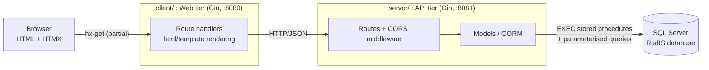

# RadisGoWeb: Clinical Patient Search & Record Viewer


-green)

A lightweight Go web front end for **RadIS**, the radiology information system I owned at Digital Health and Care Wales (NHS Wales). It lets clinical staff find a patient in seconds and drill from **patient → event history → request/appointment → procedures → reports** without full page reloads.

It is built as two small Go services: a stateless **REST API** over SQL Server and a **server-rendered web client** that uses HTMX for partial page updates.

---

## Executive Summary

**Problem.** RadIS holds a very large clinical dataset (millions of records across multiple NHS health boards). Staff needed a fast, simple way to look up a patient by several identifiers, or by ward or consultant, and then follow a record down to its appointment details and reports. The existing tooling was heavy for that quick-lookup workflow.

**Solution.** RadisGoWeb exposes the existing RadIS stored-procedure layer through a thin Go API and renders the results as HTML fragments swapped into the page by HTMX. There is no SPA framework and no client-side state. The browser asks for a fragment, the Go client renders a template, and HTMX swaps it in.

**Why Go.** Small binaries, low per-request overhead, and a very small dependency surface suit a read-heavy lookup tool that sits in front of a large database.

---

## System Architecture & Data Flow



**Request lifecycle (example: opening a request's reports)**

1. The user clicks "View Report" on the Request Details panel. HTMX fires `GET /radisweb/reports/report-details/{requestId}` on the client service.
2. The client handler calls the API twice (`request-details` and `report-details`), unmarshals both JSON payloads, and renders `reports.html`.
3. The API handlers call model functions that run `EXEC RadisWebRequestDetails ...` and `EXEC RadisWebReportDetails ...` through GORM and return JSON.
4. HTMX swaps the returned HTML into `#request-details-container`.

### Project layout

```
RadisGoWeb/
├── client/                      # Web tier (server-side rendering + HTMX)
│   ├── main.go                  # Gin engine, static files, template loading (:8080)
│   ├── routes/                  # Handlers that call the API and render templates
│   │   ├── routes.go
│   │   ├── patients.go          # Search handlers (basic, advanced, ward, consultant)
│   │   ├── events.go            # Patient details + event history
│   │   ├── requests.go          # Request/appointment + procedures
│   │   └── reports.go           # Request + report details
│   └── templates/               # index, search_results, event_history,
│                                # appointments, reports, header
└── server/                      # API tier (Gin + GORM, :8081)
    ├── main.go                  # DB init, CORS, route registration
    ├── database/db.go           # Connection pool configuration
    ├── models/                  # Data access (stored procedures + queries)
    ├── routes/                  # REST handlers
    ├── middlewares/             # CORS + JWT authentication middleware
    ├── utils/                   # bcrypt hashing + JWT helpers
    └── api-test/                # .http request collection (one file per endpoint)
```

---

## Key Technical Features

**Search**
- Basic search by RadIS number, NHS number, or hospital number.
- Advanced search by surname, forename, date of birth, and sex.
- Ward and consultant views, each in two flavours: *patients examined in the last 7 days* and *patients with scheduled or on-hold appointments*.
- Ward and consultant drop-downs are populated from reference-data endpoints.

**Drill-down record viewer**
- Patient demographics header with deceased-patient flag, then a full event history table (date, status, referral, referring doctor, site, ward, examinations).
- Status cells are colour-coded in the template (e.g. *Did not Attend*, *Cancellation*, *Rejected* flagged as danger, *Report Validated* as success).
- Request details cover priority, appointment, referring practice address, transport, clinical details, and booking info.
- Procedures table and report metadata (author, transcriber, validator, status, created and validated dates) are available per request.
- Reports carry a prominent "must not be printed or acted on" banner, because this viewer is a lookup aid and not a clinical-reporting system.
- Null-safe rendering throughout (`UNKNOWN` fallbacks, pointer-typed fields for nullable columns) so partial records never break a page.

**Data access and safety**
- Business logic stays in the database. Most reads go through RadIS stored procedures (`RadisWebPatientDetails`, `RadisWebPatientHistory`, `RadisWebRequestDetails`, `RadisWebProcedureDetails`, `RadisWebReportDetails`, `RadisWebListLocations`, `RadisWebListConsultants`, and the ward/consultant patient lists) with bound parameters.
- Where the identifier column is selectable (basic search), the field name is **whitelisted** (`radisnumber`, `nhsnumber`, `hospitalnumber`) and the value is parameterised, so user input never reaches the SQL as a column name or raw string.
- GORM prepared-statement sessions are used for repeated queries.
- Connection pool is tuned explicitly: 10 max open connections, 5 idle, 30 minute lifetime.
- The API only accepts `GET` and restricts CORS to the web client's origin.
- **Authentication groundwork is in place**: bcrypt password hashing (cost 14), HS256 JWT issue/verify with a 2 hour expiry, and an `Authenticate` middleware with a protected route group ready for use.

**Frontend approach**
- Server-rendered Go `html/template` pages, with HTMX attributes (`hx-get`, `hx-target`, `hx-swap`) doing all navigation. There is no bundler and no client framework.
- Light/dark theme toggle and a sidebar-driven patient workspace.

---

## API Reference (server, `:8081`)

| Area | Endpoint | Query params |
|---|---|---|
| Patients | `GET /radisweb/patients/id-search` | `field`, `id` |
| | `GET /radisweb/patients/advanced-search` | `surname`, `forename`, `dob`, `sex` |
| | `GET /radisweb/patients/surname` | `surname` |
| | `GET /radisweb/patients/patient-details` | `patientId` |
| | `GET /radisweb/patients/patient-history` | `patientId` |
| | `GET /radisweb/patients/by-ward` / `by-ward-last-week` | `locationId` |
| | `GET /radisweb/patients/by-consultant` / `by-consultant-last-week` | `clinicianPracticeId` |
| Requests | `GET /radisweb/requests/request-details` | `requestId` |
| Procedures | `GET /radisweb/procedures` | `requestId` |
| Reports | `GET /radisweb/reports/report-details` | `requestId` |
| Film library | `GET /radisweb/library-transactions` | `patientId` |
| | `GET /radisweb/library-details` | `siteLibraryId` |
| Reference data | `GET /radisweb/data/consultants`, `GET /radisweb/data/locations` | none |

Every endpoint returns JSON and uses consistent status codes: `400` for missing parameters, `404` when nothing matches, `500` on database errors.

Ready-made requests for all of these live in `server/api-test/*.http` (VS Code REST Client / JetBrains HTTP Client).

---

## Testing & Quality Assurance

- **Manual API verification:** each endpoint has a dedicated `.http` request file in `server/api-test/`.
- **Automated tests:** none yet. See the roadmap below. The model layer is a thin wrapper over stored procedures, so the highest-value tests are handler tests with a mocked model layer and integration tests against a seeded SQL Server container.

---

## Setup

### Prerequisites
- Go 1.21+
- A SQL Server instance containing a RadIS-compatible schema and the `RadisWeb*` stored procedures listed above (the schema is not included in this repository)

### Configure
Database settings currently live in `server/database/db.go` (`server` and `database` constants). Point them at your instance. The JWT signing secret is in `server/utils/jwt.go`. Replace it before any real deployment (see roadmap).

### Run

```bash
# 1. API tier (port 8081)
cd server
go mod download
go run main.go

# 2. Web tier (port 8080), in a second terminal
cd client
go mod download
go run main.go
```

Open **http://localhost:8080**. The client expects the API at `http://localhost:8081`, and the API's CORS policy expects the client at `http://localhost:8080`.

> This repository contains no patient data. Use synthetic or anonymised data when running it locally.

---

## Roadmap

- [ ] Load database settings and the JWT secret from environment variables, and remove them from source
- [ ] Wire the existing `Authenticate` middleware onto the patient, request, and report routes, and add login
- [ ] URL-encode query parameters when the web tier calls the API (`url.QueryEscape`), and validate inputs before hitting the database
- [ ] Return an explicit `Content-Type`/status check from the client when the API responds with a non-200 (for example, a `404` for "no patients found")
- [ ] Handler unit tests plus a Docker Compose integration environment (SQL Server + seeded data)
- [ ] CI pipeline (build, vet, test) and a Dockerfile per service
- [ ] Structured logging in place of `fmt.Print` and GORM debug mode

---

## Tech Stack

Go 1.21 · Gin · GORM (SQL Server driver) · SQL Server / T-SQL stored procedures · HTMX · Go `html/template` · bcrypt · JWT (HS256)

## Author

**Ahmed Khatib**: Software Engineer (.NET Core · Odoo · Oracle Integration Cloud), BSc Computer Science, Swansea University. Built while working at Digital Health and Care Wales (NHS Wales).
